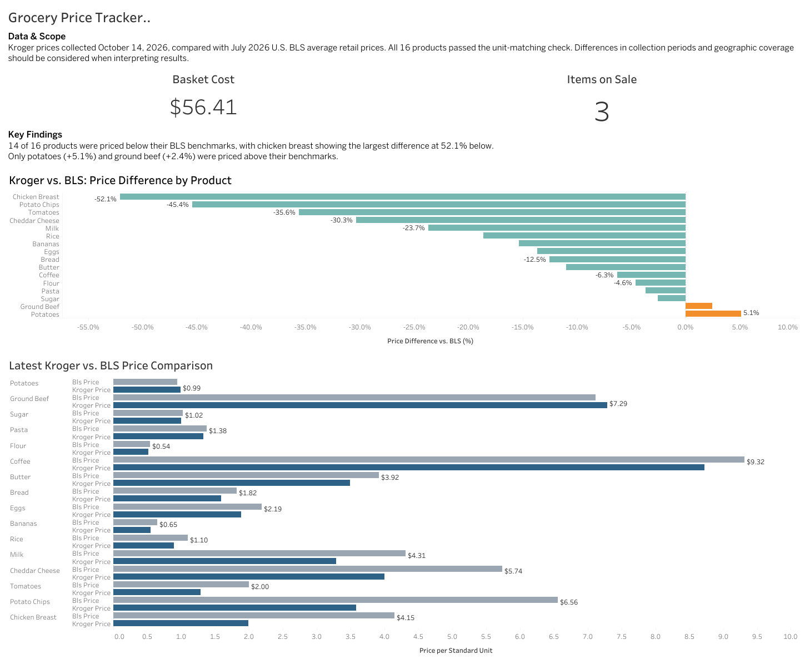
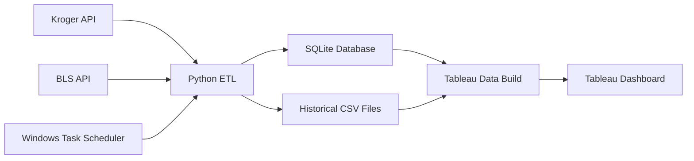

# Grocery Price Tracker

An end-to-end data analytics project that collects Kroger grocery prices and compares a standardized selection of products against U.S. Bureau of Labor Statistics (BLS) average retail-price benchmarks.

The project combines API data collection, Python ETL, SQLite, automated scheduling, and Tableau to analyze current price differences, promotions, and basket costs. Historical observations are retained in the underlying pipeline.

## Dashboard Preview

**[Explore the interactive Tableau Public dashboard](https://public.tableau.com/app/profile/tenchi.chen/viz/grocery_price_tracker1/GroceryPriceTracker)**



*Published example: Kroger prices observed October 14, 2026, compared with July 2026 BLS average retail prices. The dashboard is a dated comparison snapshot, not a live same-day price feed.*

## Project Overview

The Grocery Price Tracker collects daily prices for a basket of 22 grocery products from the Kroger API. The dashboard compares 16 grocery products with the corresponding BLS average retail-price benchmarks, after unit standardization.

The project was built to answer questions such as:

- How do current Kroger prices compare with national food-price benchmarks?
- Which individual products show the largest differences from BLS benchmarks?
- Which tracked products are currently on sale?
- What does the current 22-item grocery basket cost?
- How can products with different package sizes be compared consistently?
- What do differences in observation dates and geographic coverage mean for interpretation?

## Tech Stack

- **Python** for data collection, transformation, and pipeline development
- **Pandas** for cleaning and preparing analytical datasets
- **REST APIs** for Kroger and BLS data acquisition
- **SQLite / SQL** for structured historical price storage
- **Windows Task Scheduler** for automated daily collection
- **Tableau** for interactive dashboards and visualization
- **Git / GitHub** for version control and project documentation

## Data Pipeline



### Daily Workflow

1. Authenticate with the Kroger API
2. Retrieve prices for 22 selected grocery products
3. Capture regular and promotional prices
4. Normalize package prices into comparable standard units
5. Append new observations to historical storage
6. Update the SQLite database
7. Rebuild Tableau-ready datasets
8. Refresh the local Tableau workbook with the latest observations (the published Tableau Public snapshot is updated separately)

## Dashboard Features

### Price Difference by Product (%)

A sorted diverging bar chart compares prices for 16 grocery products against BLS average retail-price benchmarks on a common unit basis. Negative values indicate a Kroger price below the benchmark; positive values indicate a price above it. Hover tooltips show the product's Kroger price, BLS benchmark, percentage gap, and whether the item is above or below BLS.

For the October 14, 2026 Kroger vs. July 2026 BLS snapshot, 14 of 16 products were below their BLS benchmarks. Chicken breast showed the largest difference (-52.1%); potatoes (+5.1%) and ground beef (+2.4%) were the two products above their benchmarks.

### Latest Kroger vs. BLS Price Comparison

A second chart compares Kroger and BLS prices side by side in dollars, using standardized units such as:

- price per pound
- price per gallon
- price per dozen

This helps make products with different package sizes more comparable. Custom tooltips identify the price source, normalized dollar value, and percentage difference from BLS.

### Current Basket Cost

The dashboard calculates the cost of purchasing one package of each of the 22 tracked Kroger products using the latest available price.

### Items on Sale

The dashboard automatically counts the number of tracked products currently on promotion.

When promotional prices are available, the underlying pipeline also calculates:

- regular price
- promotional price
- dollar savings
- percentage savings

## Data Sources

### Kroger API

Used to collect current product-level information including:

- product name
- product ID
- package size
- regular price
- promotional price
- store location

### U.S. Bureau of Labor Statistics

BLS Average Price Data supplies national retail-price benchmarks for 16 comparable grocery products. The pipeline retains historical observations beginning in 2017; the published dashboard focuses on the selected comparison snapshot.

**Snapshot caveat:** Kroger prices were observed on October 14, 2026, while the benchmark uses the July 2026 BLS reporting period. All 16 comparisons passed the dataset's unit-matching check. Because observation periods and geographic coverage differ, results should not be interpreted as same-day, same-location price differences.

## Price Standardization

Package prices cannot always be compared directly.

For example:

- an 8 oz cheese package is converted to price per pound
- a half-gallon beverage is converted to price per gallon
- eggs are standardized to price per dozen

The pipeline calculates:

```text
Normalized Price = Effective Package Price / Standardized Quantity
```

The effective price uses the promotional price when a valid promotion exists and otherwise uses the regular price.

## Project Structure

```text
grocery-price-tracker/
│
├── assets/
│   └── dashboard.png
│
├── data/
│   ├── products.csv
│   ├── price_history.csv
│   └── bls_price_history.csv
│
├── scripts/
│   ├── kroger_auth.py
│   ├── get_locations.py
│   ├── get_products.py
│   ├── collect_prices.py
│   ├── init_database.py
│   ├── check_database.py
│   ├── get_bls_history.py
│   ├── check_bls.py
│   ├── build_tableau_data.py
│   └── run_daily_collection.bat
│
├── tableau/
│   ├── price_history_long.csv
│   ├── latest_price_comparison.csv
│   └── grocery_price_tracker.twbx
│
├── .gitignore
└── README.md
```

## Automation

The Kroger collection pipeline runs through Windows Task Scheduler.

```text
Scheduled Task
      ↓
Kroger API Collection
      ↓
Historical CSV + SQLite
      ↓
Tableau Data Build
      ↓
Updated Dashboard Data
```

Raw daily API snapshots and execution logs are stored locally but excluded from GitHub.

## Security

API credentials are stored in a local `.env` file and loaded through environment variables.

The following are excluded from version control:

- `.env`
- SQLite database files
- raw API snapshots
- execution logs
- Tableau temporary files

No Kroger API credentials are stored in this repository.

## Skills Demonstrated

- Python scripting
- Pandas data transformation
- REST API integration
- SQL and SQLite
- ETL pipeline development
- Data normalization
- Historical data collection
- Workflow automation
- Data quality validation
- Tableau dashboard development and publishing
- Data storytelling, dashboard annotations, and interactive tooltips
- Benchmark price comparisons
- Data visualization
- Git and GitHub version control

## Future Improvements

Potential extensions include:

- comparing multiple grocery retailers
- tracking prices across geographic locations
- expanding the product basket
- calculating a custom grocery inflation index
- adding weekly and monthly price-change metrics
- migrating the automated pipeline to a cloud environment
- automating refreshes of the published Tableau Public data snapshot
